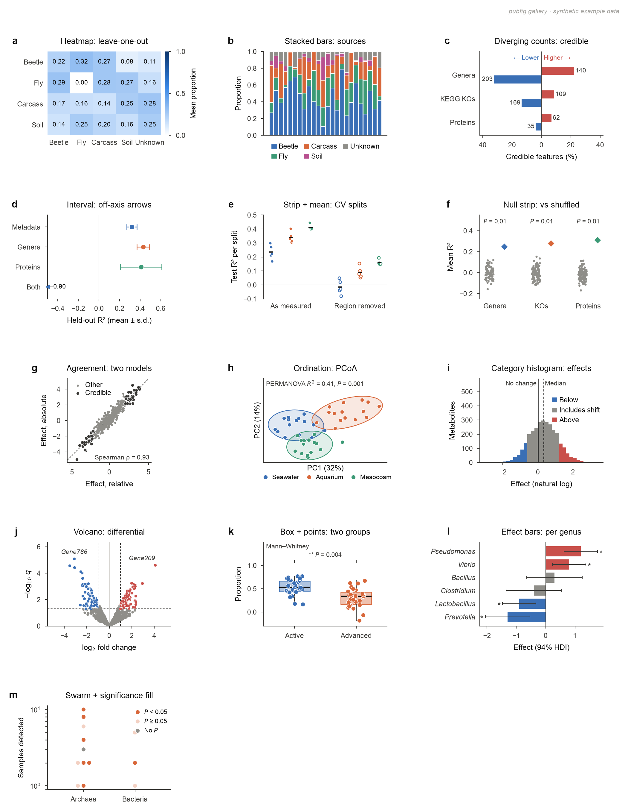

# pubfig

Nature-format print style, chart helpers and layout checks for matplotlib figures. This is the shared figure style first written for the minderoo multi-omics paper, pulled out so other projects can reuse it.

## Install

```bash
pip install "git+ssh://git@github.com/jbk708/pubfig.git"
# or, for local edits
git clone git@github.com:jbk708/pubfig.git && pip install -e pubfig
```

## Use

```python
import matplotlib.pyplot as plt
import pubfig as pf          # importing applies the print style (rcParams)

fig = plt.figure(figsize=(pf.WIDTH, 120 * pf.MM))
ax = fig.add_subplot()
pf.box_strip(ax, values, 0, pf.CATEGORICAL[0])
pf.bracket(ax, 0, 1, 1.05, f"{pf.stars(q)}\n{pf.p_text(q, 'q')}")
ax.set_title("Wilcoxon: change with stage")
pf.label(ax, "a")

pf.require_layout(fig)       # exits without writing if text overlaps, runs off the page, is < 5 pt, or > 183 mm
pf.save(fig, "figures", "fig1")   # -> figures/fig1.{svg,pdf,png}
```



`examples/gallery.py` draws the page above (seeded synthetic data). It must pass the layout check, and the tests run it, so it is also the regression check for every chart form.

### Chart forms

Each form is ported from the figure code that first drew it; the last column says where.

| Function | Draws | Earlier use |
|---|---|---|
| `heatmap` | matrix with every value printed, black or white ink chosen by contrast, optional colour bar | PERMANOVA R² (minderoo Fig. 2a), sample-type effects, FEAST leave-one-out, confusion matrices |
| `stacked_bars` | proportions per sample, white hairline gaps between segments | FEAST source proportions, class shares |
| `diverging_counts` | % of features credibly higher / lower per row, with counts and in-panel direction labels | minderoo Fig. 3c |
| `interval_point` | estimate ± interval; ends beyond the axis become arrowheads, an off-axis estimate becomes an edge arrow with its value | minderoo Fig. 2b |
| `strip_mean` | every value (e.g. CV split) as a dot, with a mean tick; open markers for a second condition | stress Extended Data a, b, d, e |
| `null_strip`, `permutation_p` | permutation null cloud vs observed diamond, with *P* (+1 corrected) | stress Extended Data c, archaea a |
| `agreement` | effect vs effect, highlighted subset, identity or shift line, Spearman ρ note | minderoo Fig. 3b, e, h; archaea c |
| `ordination` | PCoA/PCA by group with 2-s.d. ellipses, axes "PC1 (x%)", limits that keep room for notes | sample-type comparisons |
| `category_hist` | stacked histogram coloured by category, labelled reference lines | minderoo Fig. 3g |
| `volcano` | effect vs −log10 *q*, coloured by direction when significant, optional names | spatial transcriptomics |
| `box_strip` (+ `bracket`, `stat_note`) | box with every point, significance bracket, test name | FEAST stage tests, sample types |
| `effect_bars` | diverging effect bars with intervals, star when credible, italic names | minderoo Fig. 3a, d |
| `sig_scatter`, `sig_colour`, `swarm_offsets` | points pale when *P* ≥ 0.05 and grey with no *P*; deterministic non-overlapping offsets for small n | archaea Extended Data |
| `ellipse` | covariance ellipse (returns the patch) | ordinations |

### Style, layout and saving

| Name | What |
|---|---|
| `WIDTH`, `SINGLE`, `MAX_HEIGHT`, `MM` | 183 mm / 89 mm / 170 mm page sizes; `MM` converts mm to inches |
| `CATEGORICAL` | three muted hues that pass the colour-blind validator for all pairs (scatter, boxes) |
| `CATEGORICAL_STACK` | four hues in an order that passes for adjacent pairs (stacked bars only); a grey "other" may follow |
| `DIV_NEG`, `DIV_POS`, `PH`, `NS_ALPHA` | the diverging blue/red pair; grey for "interval crosses 0" or no *P*; pale alpha for *P* ≥ 0.05 |
| `SEQ`, `SEQ_CMAP` | single-hue blue ramp for magnitudes (`SEQ_CMAP` starts at white) |
| `INK`, `INK2`, `GRID`, `LAND`, `DASH` | primary ink, secondary ink `#3a3936`, gridline, land fill, dash pattern |
| `MIN_FS`, `FILL_ALPHA`, `AREA_ALPHA`, `DOT` | the 5 pt text floor, box and area fill alphas, point style |
| `label(ax, "a", dx=-11)` | bold lowercase panel letter on the title baseline (move it left with `dx` past long tick labels) |
| `axes_mm` | axes placed in mm from the figure's top-left corner |
| `italic_ticks`, `legend_markers` | italic taxon tick labels; a frameless legend of filled circles |
| `bracket`, `stars`, `p_text(p, "q")`, `stat_note` | statistics annotations |
| `text_on`, `luminance` | black or white text, picked by computed contrast with the fill |
| `check_layout`, `require_layout` | pre-save checks: text overlapping text or a data point, text off the page or under 5 pt, points clipped by their axes, width over 183 mm |
| `save`, `watermark` | write SVG + PDF + PNG; optional watermark for mockups |
| `use()` | re-apply the rcParams after a script overrides some |

### Not included (draw per project)

These forms each appeared once and are too tied to their figure to share:
- **Maps:** cartopy, with label placement that searches for free space.
- **UpSet plots:** the `upsetplot` package.
- **Box-and-arrow workflow and sample-flow diagrams.**
- **Tables drawn as figures.**

Draw them with the style constants and run `check_layout` on the result.

## Fonts

The type is Nimbus Sans (Helvetica class). On barnacle it is installed on the login node only, and the compute nodes fall back to DejaVu Sans, so render final figures on the login node. On a Mac, Arial is used: matplotlib cannot load macOS Helvetica (`Helvetica.ttc`) glyphs at 5 pt on its 100 dpi canvas, which breaks the layout check. Nature accepts either typeface.

## Style rules

[`STYLE_GUIDE.md`](STYLE_GUIDE.md) is the full reference: page and output, type, colour, marks, statistics, titles and layout, each with its value and the pubfig name that applies it. In short:
- 89 or 183 mm wide;
- Helvetica-class type at 5–8 pt, nothing below 5 pt;
- colour-blind-safe palettes, with groups named directly, never by colour alone;
- exact *P* values on the plot;
- nothing overlapping or clipped, checked by `require_layout` before saving.

## Tests

```bash
pip install -e ".[test]" && pytest
python examples/gallery.py   # re-render examples/gallery.{svg,pdf,png}
```

## License

BSD 3-Clause (see `LICENSE`).
